# AtmoSpy

A team of AI agents that investigates how Earth is changing, using real NASA data. Built for the NASA Space Apps Challenge 2026.

Every investigation answers four questions with real numbers:

- **What** changed?
- **Where** did it change, and does it change in opposite directions in different places?
- **How much** did it change?
- **Is the change statistically significant**, and is that the same as scientifically important?

| Light | Dark |
|---|---|
| 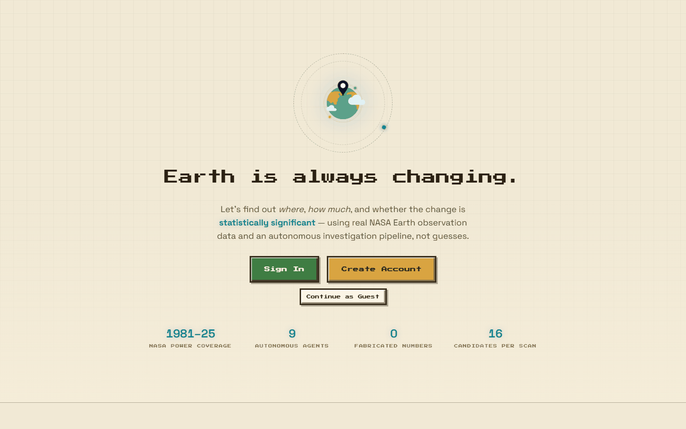 | 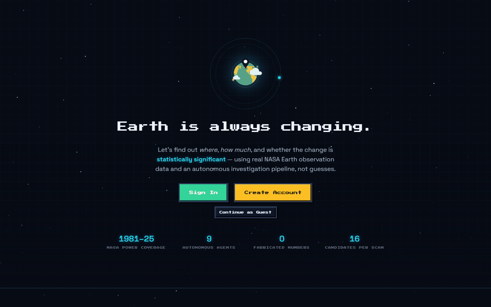 |

## Features

### Meet the crew

The landing page opens on a 3D island where the agents act out a live investigation. A glowing orb carries a real Discover topic, such as "Soil moisture · Lake Chad Basin", from agent to agent: the data agent downloads it from the satellite, statistics crunches it, trend plots it, spatial probes the grid cells, the skeptic challenges it and the report agent files it as a finding. A panel shows which stage the investigation is at. Drag to rotate the island, and click an agent to see what it does and what it is doing right now.

| Light | Dark |
|---|---|
| 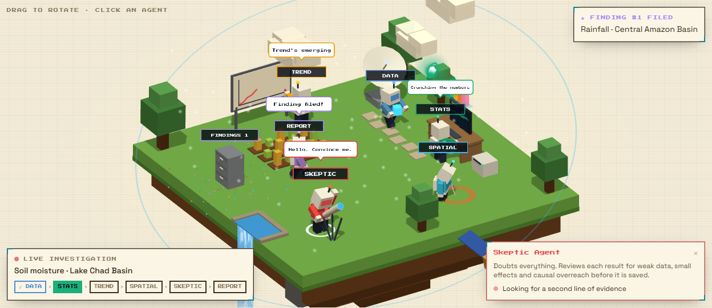 | 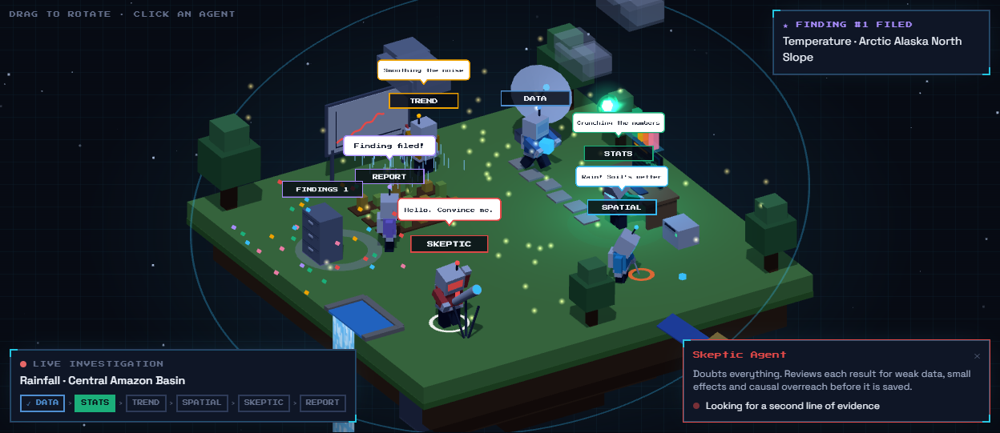 |

The scene is an illustration of the pipeline. Its topics are real Discover pairs, but it computes nothing and shows no numbers.

### Discover

One click scans 16 region and variable pairs at once. Sixteen investigations run the full agent pipeline in parallel, and the results are ranked by criteria that are shown on screen: trend size, significance, data completeness, consistency over time and spatial extent. The scan keeps running if you switch pages and picks up where it left off when you return.

| Light | Dark |
|---|---|
| 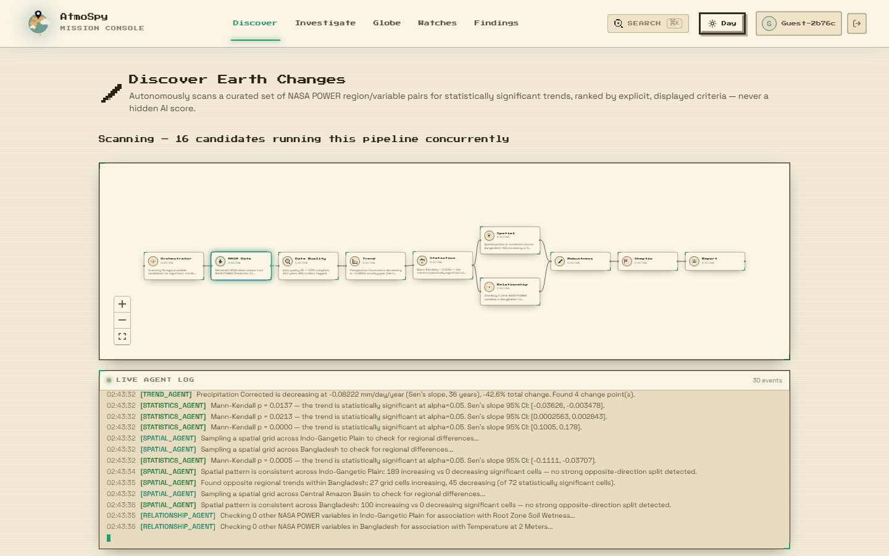 | 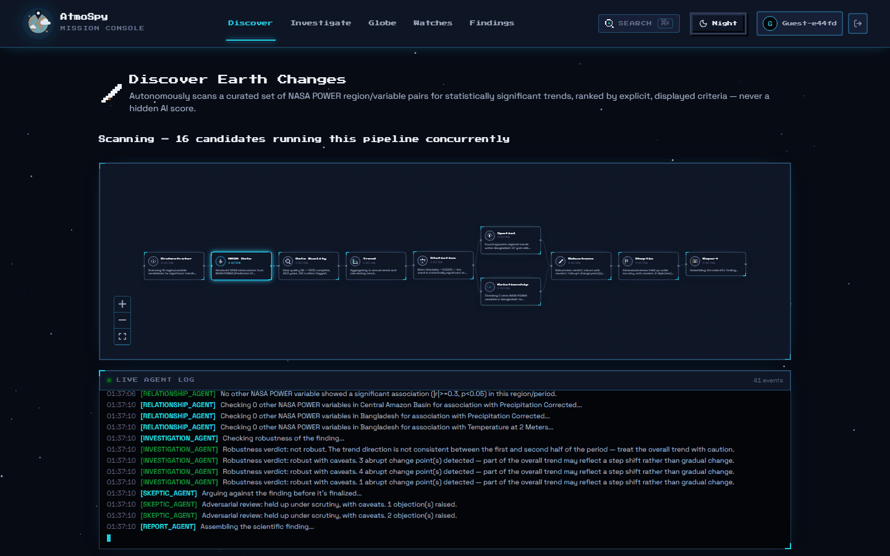 |

| Light | Dark |
|---|---|
| 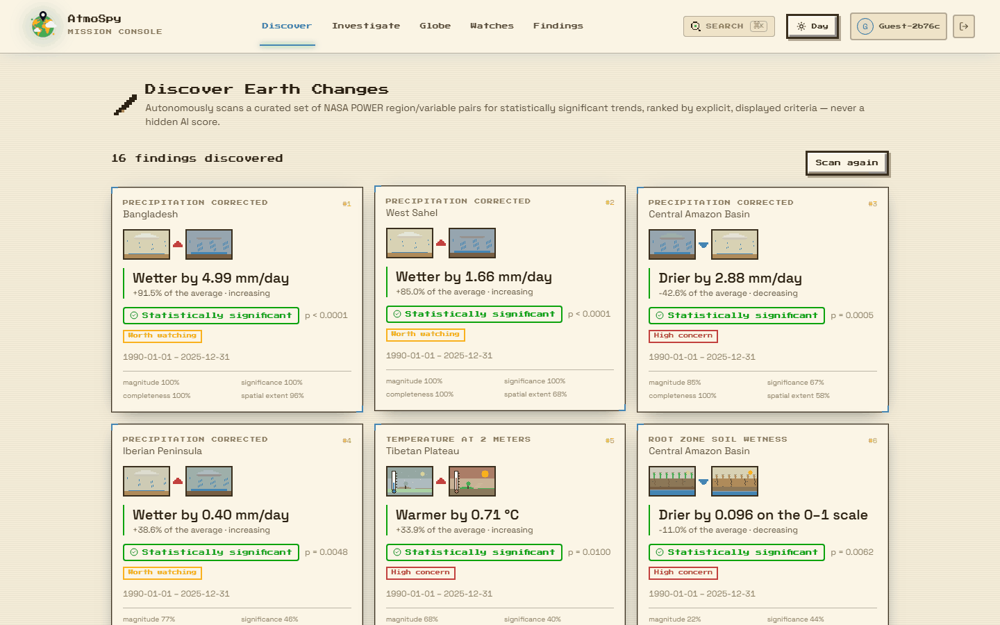 | 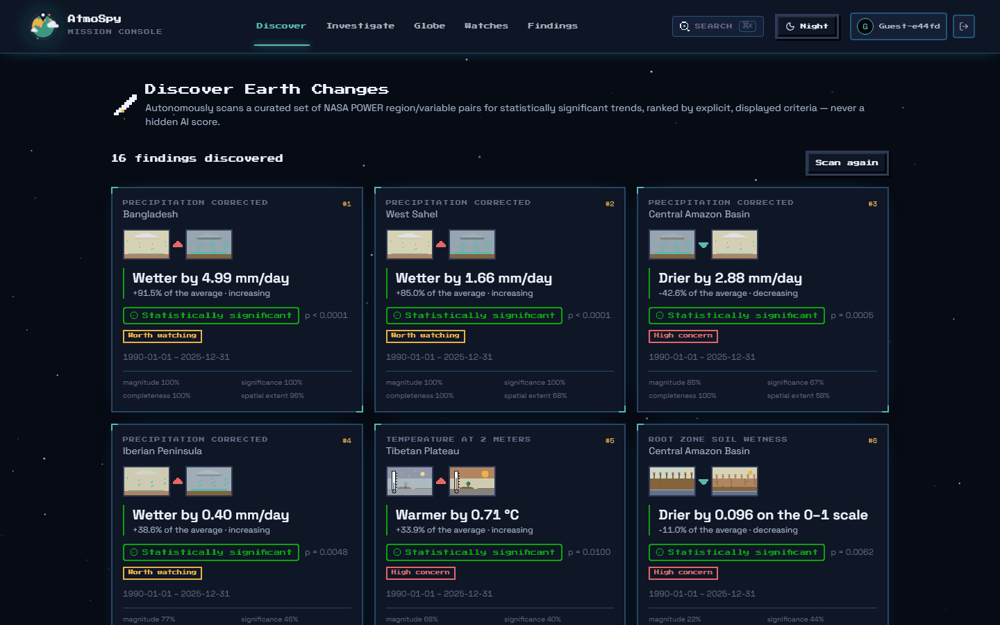 |

### Investigate

Ask a question in plain language, such as "Has temperature changed significantly in the Tibetan Plateau since 1990?" The agents plan the work, fetch the data, run the statistics and write up the result. You watch every step live as a node graph and a log.

| Light | Dark |
|---|---|
| 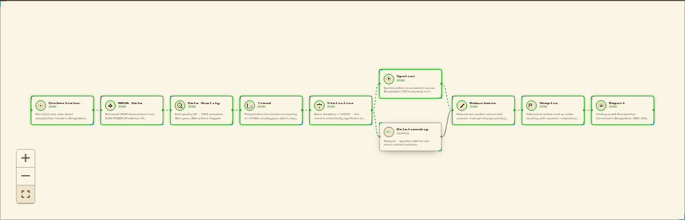 | 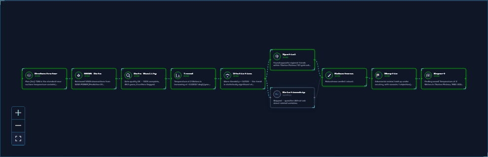 |

### Finding reports

Each finding shows what changed, where, how much and how sure we are. A pixel art scene morphs from the start to the end of the record, and its size follows the effect size, not just the p value. Reports also include a time series with a confidence band, a spatial map of every grid cell, an adversarial review and a "why it may be happening" panel written from cited sources.

| Light | Dark |
|---|---|
| 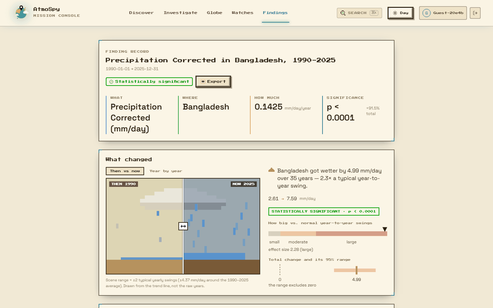 | 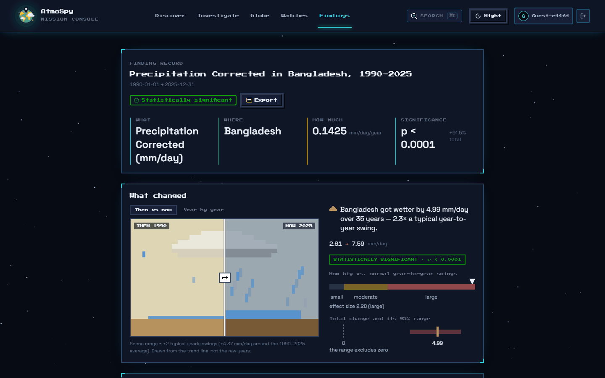 |

| Light | Dark |
|---|---|
| 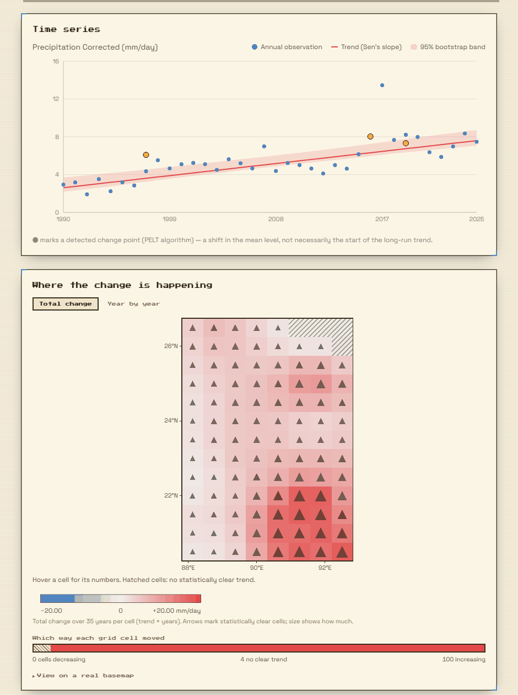 | 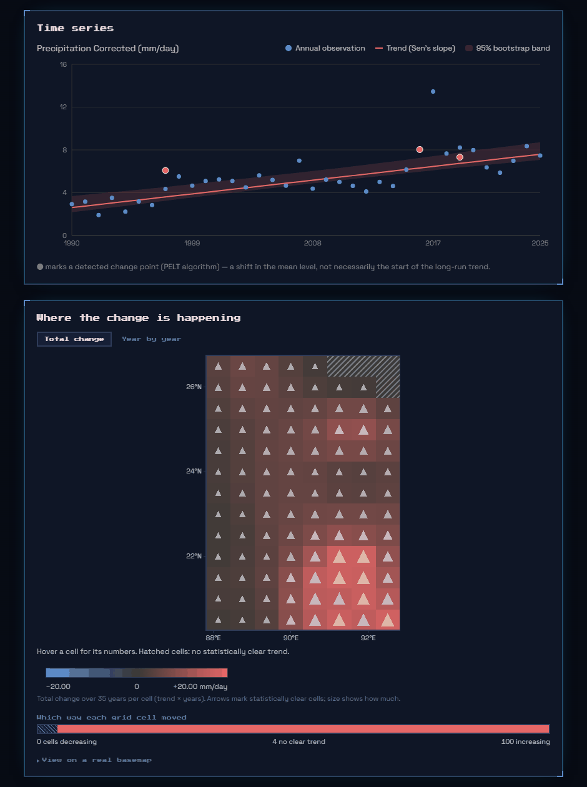 |

### Globe

Every finding plotted where it happened, with the direction of the biggest change in each region.

| Light | Dark |
|---|---|
| 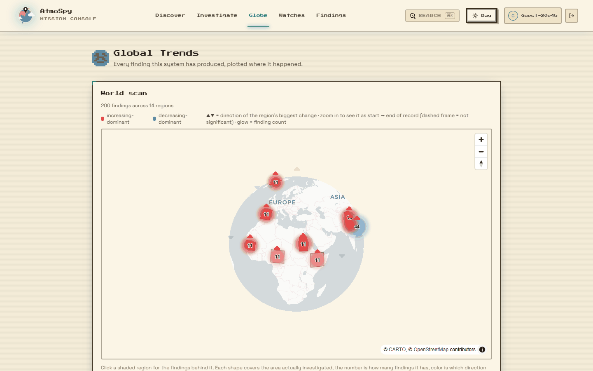 | 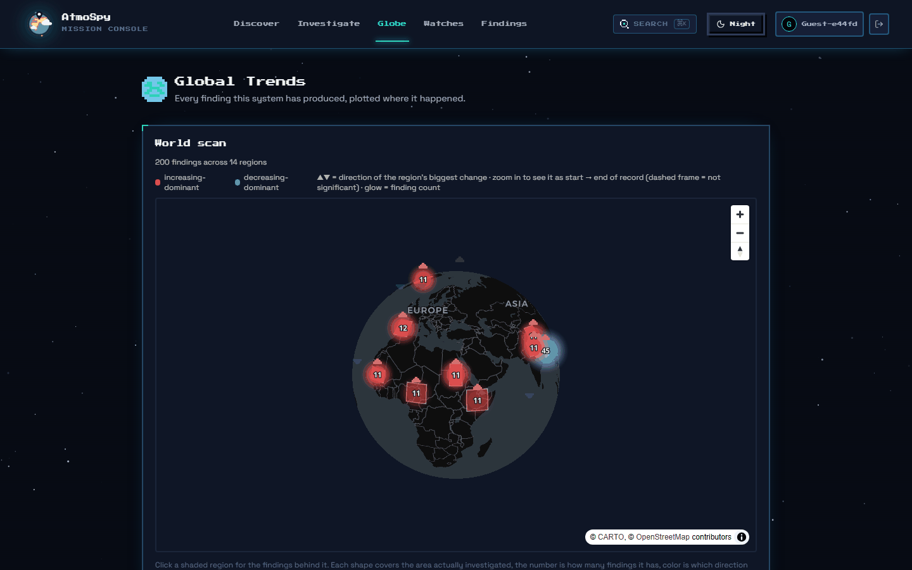 |

### Watches

Sign in to subscribe to a region and variable pair. The pipeline reruns on a schedule and flags whether anything changed since the last check.

### Detect

A guided path for students in four short questions. Pick a kind of place (city air, desert, rainforest, coast, ice, ocean, farmland, mountains or river basin), choose a region on a map or draw your own box, pick from suggested variables, each with a plain definition and a one sentence reason it may be changing there, then pick the years and, for variables at several heights, the level in the atmosphere. Suggestions come from tags in the variable catalog; when a Groq key is set the LLM may reorder them and write the reasons, but it can only choose from the catalog and its reasons may not contain numbers.

### What is changing here?

One button tests every available variable over a region with the same trend test, corrects for testing many at once, and ranks the results. Click any row to run the full investigation over the same years.

### Learn and demos

Every science word in the app has a popover definition, collected on the Learn page. The Demos page replays real investigations with a captioned walkthrough: the seasonal cycle hiding Arctic warming, a trend that is real but not significant yet, groundwater loss seen by GRACE, and a scan of the Sahel. Demos are frozen as JSON by `backend/scripts/export_demos.py`, so they work even when the backend is asleep, and every caption reads its numbers from the frozen result.

### Reproduce it yourself

Each finding can be downloaded as a Jupyter notebook holding the exact series that was analyzed and a short standalone version of the statistics, which recomputes the slope and p values and checks them against the app.

## How it works

The project has two layers that never mix.

1. **A deterministic science core in Python.** Every number comes from NumPy, SciPy, pandas, statsmodels, pymannkendall and ruptures running on real NASA data. It has unit tests with known answers.
2. **An agent layer using GPT OSS 120B on Groq.** It plans the investigation and words the interpretation of numbers it is given. It cannot compute or invent a statistic, and a guardrail rejects any number in its output that does not trace back to the data.

Without a Groq key the app still works fully, using a rule based planner and a template narrator.

### The agents

| Agent | Job |
|---|---|
| Orchestrator | Turns the question into a plan and coordinates the rest |
| NASA Data | Fetches the region's grid once and averages it over the whole region, weighted by area |
| Data Quality | Checks gaps and outliers, and can force a retry with a wider window |
| Trend | Removes the seasonal cycle, then Sen's slope, trends by season and change points |
| Statistics | Autocorrelation corrected Mann Kendall and t tests, 95% confidence interval, effect size, years needed to detect |
| Spatial | Per cell trends with a false discovery rate correction, flags opposite trends |
| Relationship | Correlates detrended yearly anomalies with other variables, reported as association only |
| Investigation | Checks whether the trend holds in both halves of the period |
| Skeptic | Argues against the finding using only numbers already computed |
| Report | Assembles the finding, and the only place an LLM is called |

### Method

- **Region:** the trend is computed on the area weighted (cos latitude) average of every grid cell in the region. A month counts only when at least 70% of the region's area has data. If a source cannot give a grid for the box, the centre point is used and the report says so.
- **Seasons:** daily data become monthly means, the average for each calendar month (the climatology) is subtracted, and the trend is tested on these anomalies. Where calendar months vary very differently, such as wet and dry seasons, yearly averages are tested instead, because the median based slope would be dominated by the quiet months. On real Sahel rainfall it came out ten times too small.
- **Trend and significance:** Sen's slope with the Mann Kendall test, whose variance is inflated by (1 + r1) / (1 - r1) for the lag 1 autocorrelation r1. The same corrected variance gives Sen's 95% confidence interval. A t test on the regression slope with effective sample size n (1 - r1) / (1 + r1) (Santer et al. 2000) and the seasonal Mann Kendall test are second and third checks. The choice was made by a Monte Carlo test kept in the test suite: on trendless monthly noise with r1 = 0.6 the plain test calls about 30% of series significant, pymannkendall's Hamed Rao and Yue Wang variants 14% to 50%, and the method used here 5% to 9%.
- **Record length:** the years needed to detect a trend of this size (Weatherhead et al. 1998), so a real trend that is not significant yet is reported as exactly that.
- **Spatial and many tests:** grid cells, Discover candidates, region scans and related variables all use the Benjamini Hochberg false discovery rate.
- **Importance:** a separate effect size (total change divided by normal year to year variation, with the trend removed), so significant and important are never confused. Percent change is not shown for interval scales such as degrees Celsius.
- **Change points:** the PELT algorithm. **Robustness:** the trend is re estimated on each half of the period.
- **Known breaks:** the catalog lists changes in instruments or model inputs (for example the OMI row anomaly from 2007), and the skeptic flags any inside the period.

Findings record an analysis version, so findings made before this method keep displaying as they were and Watches treat a method change as a new baseline.

## Tech stack

| Layer | Choice |
|---|---|
| Frontend | Next.js 16, TypeScript, Tailwind CSS, React Flow, Recharts, MapLibre GL |
| Backend | FastAPI, Python 3.12, async SQLAlchemy |
| Database | PostgreSQL with PostGIS (Supabase works) |
| AI | Groq, `openai/gpt-oss-120b` |
| Data | NASA POWER; GRACE FO and SMAP with an Earthdata token; MERRA-2, GPM IMERG, GLDAS, AIRS and OMI as analysis ready Zarr cubes |

## Run it locally

You need Python 3.12 or newer, Node 22.18 or newer (the frontend tests run TypeScript directly) and Docker.

```bash
cp .env.example .env
docker compose up -d postgres

cd backend
python -m venv .venv
.venv/Scripts/activate        # or: source .venv/bin/activate
pip install -r requirements.txt
alembic upgrade head
python -m app.db.seed
uvicorn app.main:app --reload --port 8000
```

In a second terminal:

```bash
cd frontend
npm install
npm run dev
```

Open http://localhost:3000. To run everything in containers instead, use `docker compose up --build`.

### Data cubes for MERRA-2, GPM, GLDAS, AIRS and OMI

These variables are read from monthly cubes built once, offline, from NASA's cloud OPeNDAP. The app then reads only the part of a cube a region needs and never calls NASA at request time. The variable catalog is `backend/app/nasa/variables.yaml`.

```bash
cd backend
python -m scripts.build_cube --list                  # what can be built
python -m scripts.build_cube --var M2_T2M --var GPM_PRECIP
python -m scripts.build_cube --dataset MERRA2 --start 1980
```

This needs `NASA_EARTHDATA_TOKEN`, and the GES DISC data use agreement must be accepted on that Earthdata account (Earthdata Login, then your profile, then EULAs, and authorize the GES DISC application). Without it GES DISC answers "EULA Acceptance Failure" and the build stops with that message. Cubes are written to `data/cubes/` with a `manifest.json` recording each product's version, DOI and granule count. To serve them from object storage, upload the folder and set `CUBE_BASE_URL`. A variable appears in the app only once its cube exists.

### Checking the cubes against the original files

`python -m scripts.validate_cubes` recomputes regional averages from each product's native-resolution files (24 months spread over the record and the calendar) and compares them with the cube's, for five test regions from the Tibetan Plateau down to the Delhi city box. The results are saved to `data/cubes/validation.json`. For all 14 monthly cubes:

| Region size | Correlation | Bias, as a share of the month-to-month standard deviation |
|---|---|---|
| Large regions (Tibetan Plateau, Sahel, Great Plains, Indo-Gangetic Plain) | 0.9997 or higher | 4.2% at most (MERRA-2 2 m temperature over the Indo-Gangetic Plain), under 2.3% for every other cube |
| City box (Delhi) | 0.87 or higher | Up to 19% for the 0.25° GLDAS land fields (snow, runoff, soil moisture), under 2.4% for everything else |

A city box covers only a few 1° cells, so for land-water variables over a city, use a larger box. AIRS is already on a 1° grid and matches exactly. Snow over the Sahel is always zero, so it has no correlation to report. OMI NO2 is a daily product and is not part of this check.

### Checking the cubes against Giovanni

`backend/tests/test_giovanni_validation.py` compares each cube's regional average with NASA Giovanni's own area averaged time series for the same box. `backend/tests/fixtures/giovanni/cases.json` lists the four Giovanni downloads to make and save there; until both a CSV and its cube exist, that case is skipped rather than passed.

### Warming the cache

A first request for a region downloads its grid from NASA POWER (5 to 10 seconds); after that it is cached for a week (`NASA_POWER_CACHE_TTL_HOURS`). `python -m scripts.prewarm` fetches the Discover and demo regions ahead of time, and `--all-presets` adds every preset region with its suggested variables. With a warm cache a full investigation, including related variables, takes about 6 to 7 seconds; most of that is the LLM write up.

### Demos

With the backend running, `python -m scripts.export_demos` reruns the demo cases and writes them to `frontend/public/demos/`. Demos that need a cube that is not built yet are skipped.

### Environment variables

| Variable | Purpose |
|---|---|
| `DATABASE_URL` | Postgres connection string |
| `GROQ_API_KEY` | Optional. Turns on LLM planning and narration |
| `NASA_EARTHDATA_TOKEN` | Optional. Turns on GRACE FO and SMAP, and lets `build_cube` download GES DISC data |
| `CUBE_BASE_URL` | Optional. Folder or http(s) URL of the data cubes. Defaults to `data/cubes` |
| `CORS_ORIGINS` | Allowed frontend origins |
| `JWT_SECRET` | Signs login tokens. Must be changed in production |
| `NEXT_PUBLIC_API_URL` | Backend URL used by the browser |

### Tests

```bash
cd backend && pytest
cd frontend && npm run test
```

With both servers running, `node scripts/smoke-test.mjs http://localhost:3000` (in `frontend/`) loads every page in a real browser, fails on any console error, and runs an axe accessibility audit (WCAG 2 A and AA) on the main pages, failing on serious or critical violations. CI runs it too.

## Deployment

The frontend deploys to Vercel, the backend to Render using `render.yaml`, and the database to Supabase. Set `NEXT_PUBLIC_API_URL` on Vercel to the Render URL, then set `CORS_ORIGINS` on Render to the Vercel URL.

## Limitations

- NASA POWER, MERRA-2 and GLDAS are reanalysis and model data, not direct satellite measurements.
- A regional average can hide differences inside the region. The per cell map shows them.
- NASA POWER grid requests are limited to 10 degree boxes; larger boxes fall back to the centre point.
- Only monotonic trends are tested. Curved or step changes are flagged by the change point and robustness checks, not modelled.
- SMAP downloads one file per month, so it is left out of quick scans and relationship checks.
- MODIS aerosol (MOD08_M3) is not included: LAADS's OPeNDAP service needs an interactive Earthdata login rather than a token, and the full files are about 276 MB a month.
- Relationships are correlations only and never claim a cause.
- Discover scans a curated list of 16 pairs, not the whole globe.
- The rate limiter, cache, event bus and Watch scheduler run in one process, so the backend is meant to run as a single instance.
- Expensive requests are rate limited per IP: 30 investigations a minute, 10 region scans and 3 Discover runs per 10 minutes, 60 suggestion requests a minute. A whole classroom behind one school IP shares these limits.

## Credits

Pixel art scenery is from Kenney's [Tiny Farm](https://kenney.nl/assets/tiny-farm), released under CC0. Not an official NASA product, and NASA does not endorse this project.
